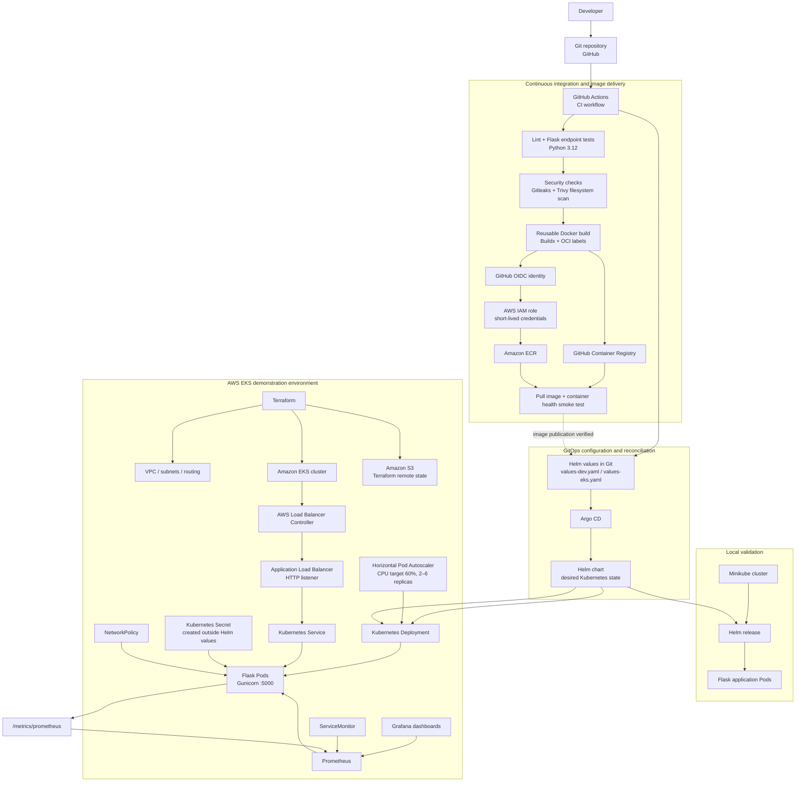

# Production-Grade DevOps Platform

<p align="center">
  <strong>Multi-environment CI/CD, GitOps delivery, Kubernetes orchestration and cloud-native observability</strong>
</p>

<p align="center">
  <a href="https://github.com/shivam535353/production-grade-devops-platform"></a>
  
  
  
  
  
  
  
  
  
  
</p>

**Author:** Shivam Gadilkar  
**Repository:** [shivam535353/production-grade-devops-platform](https://github.com/shivam535353/production-grade-devops-platform)  
**Cloud region used for the EKS demonstration:** `ap-south-1` (Asia Pacific — Mumbai)

---

## Table of contents

- [Overview](#overview)
- [Problem statement](#problem-statement)
- [Architecture](#architecture)
- [End-to-end workflow](#end-to-end-workflow)
- [Technology stack](#technology-stack)
- [Repository structure](#repository-structure)
- [Implementation phases and proof of work](#implementation-phases-and-proof-of-work)
- [Application endpoints](#application-endpoints)
- [Run locally](#run-locally)
- [Run with Docker](#run-with-docker)
- [Kubernetes and Helm deployment](#kubernetes-and-helm-deployment)
- [AWS deployment notes](#aws-deployment-notes)
- [Security design](#security-design)
- [Engineering challenges and learnings](#engineering-challenges-and-learnings)
- [Future improvements](#future-improvements)
- [Cost and lifecycle note](#cost-and-lifecycle-note)
- [License](#license)

## Overview

The **Production-Grade DevOps Platform** is an end-to-end engineering project that demonstrates how to package a Python web application, validate it through CI, scan source code and container artifacts, publish versioned images, and deploy Kubernetes workloads using Helm and Argo CD.

The platform was developed incrementally: first as a Flask application and Docker container, then on local Kubernetes (Minikube), and finally as an AWS EKS demonstration. It includes GitOps-managed development/production application definitions, infrastructure-as-code, application metrics, Prometheus/Grafana observability, horizontal pod autoscaling and Kubernetes network-policy validation.

The project emphasizes repeatable delivery, explicit configuration, least-privilege cloud access, health checks, and operational evidence rather than a one-command demo.

## Problem statement

A working application is only one part of a reliable delivery platform. Teams also need a repeatable way to:

- build consistent container images;
- catch code and security issues before publishing;
- promote immutable image references through environments;
- keep Kubernetes desired state in version control;
- observe service health and workload behavior;
- scale application replicas as demand changes; and
- provision cloud infrastructure in a reproducible, reviewable way.

This repository brings those practices together in one demonstrable workflow.

## Architecture

The diagram below shows the main delivery path and the two runtime targets used in the project: a local Minikube environment and an AWS EKS demonstration environment.



### Architecture notes

- **CI is the quality gate:** the workflow runs Python lint/format checks and Flask endpoint tests before the security and image-delivery stages.
- **Image publication:** the reusable Docker workflow builds a Linux AMD64 image and publishes to GHCR and, when configured, Amazon ECR. AWS authentication uses GitHub's OIDC identity to assume a scoped IAM role rather than storing long-lived AWS access keys in GitHub secrets.
- **GitOps:** Argo CD observes the repository and reconciles the Helm chart into Kubernetes. The current `gitops-update` job updates `helm/devops-platform/values-dev.yaml` on a push to `main`; the EKS demo configuration is represented separately by `values-eks.yaml`.
- **Runtime:** the Flask application runs in Kubernetes Pods behind a Service. The EKS demo used an AWS Application Load Balancer through the AWS Load Balancer Controller.
- **Observability and scaling:** a ServiceMonitor exposes application metrics to Prometheus; Grafana visualizes the metrics; the HPA uses CPU utilization to adjust replicas.
- **Infrastructure state:** Terraform remote state is stored in an S3 backend. The EKS demo stack was destroyed after validation to avoid ongoing cloud charges; see [Cost and lifecycle note](#cost-and-lifecycle-note).

## End-to-end workflow

1. A developer pushes code or opens a pull request against `main`.
2. GitHub Actions checks out the repository, installs Python dependencies, runs `flake8`, checks formatting with Black and tests the Flask endpoints.
3. The security job scans repository history with Gitleaks and the filesystem with Trivy (CRITICAL severity, ignoring unfixed findings).
4. The reusable Docker workflow builds the image with Buildx. For push events it authenticates to GHCR and uses GitHub OIDC to assume the configured AWS role for ECR publishing.
5. The verification job pulls the SHA-tagged image, starts a container and checks `/health`.
6. On a push to `main`, the GitOps update job changes the image tag in `helm/devops-platform/values-dev.yaml` and pushes the change. Argo CD can then reconcile the updated development Helm release.
7. The EKS demonstration used a separate EKS Helm values file and Argo CD application configuration. The EKS image/configuration update should be treated as a separately controlled deployment step, not as an automatic result of the `values-dev.yaml` update job.

## Technology stack

| Area | Technologies | Purpose |
|---|---|---|
| Application | Python 3.12, Flask 3.1, Werkzeug | Web application and API endpoints |
| Production serving | Gunicorn | WSGI application server |
| Containerization | Docker, multi-stage Dockerfile | Reproducible, smaller runtime image; non-root execution |
| Local orchestration | Kubernetes, Minikube | Local cluster development and validation |
| Packaging | Helm | Parameterized Kubernetes manifests and environment-specific values |
| GitOps | Argo CD | Continuous reconciliation from Git |
| CI/CD | GitHub Actions, reusable workflow, Docker Buildx | Tests, security checks, image build and publishing |
| Image registries | GHCR, Amazon ECR | Versioned container image storage |
| Infrastructure as code | Terraform | AWS infrastructure and IAM/ECR provisioning |
| AWS | EKS, VPC, IAM, S3, ECR, Application Load Balancer | Managed Kubernetes and cloud networking |
| Ingress | AWS Load Balancer Controller | ALB provisioning from Kubernetes Ingress |
| Metrics | Prometheus, prometheus-flask-exporter, ServiceMonitor | Application and cluster metrics collection |
| Dashboards | Grafana | Operational dashboards and visualization |
| Security | Gitleaks, Trivy, Kubernetes SecurityContext, NetworkPolicy | Secret scanning, vulnerability scanning and workload/network hardening |
| Secret workflow | Kubernetes Secret / Sealed Secrets tooling | Keep runtime secret values out of Helm values and ordinary source configuration |

## Repository structure

The following is a focused map of the repository's main implementation areas.

```text
production-grade-devops-platform/
├── .github/
│   └── workflows/
│       ├── ci-cd.yml
│       └── reusable-docker-build.yml
├── argocd/                   # Argo CD Application and GitOps configuration
├── charts/
│   └── templates/            # Kubernetes chart/template assets
├── docs/
│   ├── evidence/             # Captured CLI evidence and resource snapshots
│   └── screenshots/          # Phase-by-phase implementation screenshots
├── eks-addons/               # EKS add-on configuration
├── helm/
│   └── devops-platform/      # Application Helm chart and values files
├── k8s/                      # Kubernetes manifests and supporting resources
├── loadtest/                 # Load-test assets
├── monitoring/               # Prometheus/Grafana and monitoring values/rules
├── src/
│   ├── config.py             # Environment-specific Flask configuration
│   ├── routes/               # Flask route blueprints
│   ├── static/               # Static frontend assets
│   └── templates/             # Application templates
├── terraform/
│   ├── bootstrap/             # Remote-state/bootstrap resources
│   ├── ci/                    # ECR and GitHub OIDC IAM resources
│   └── eks-demo/              # EKS demonstration infrastructure
├── tests/                     # Application tests
├── app.py                     # Flask application factory entry point
├── Dockerfile                 # Multi-stage, non-root container image
├── requirements.txt           # Python dependencies
└── README.md
```

## Implementation phases and proof of work

The screenshots below are the supplied project evidence files. Each image is linked using its exact filename under `docs/screenshots/`. Expand a phase to view its evidence. The captions describe the visible activity at a practical level; the screenshots are historical captures, not claims that the associated cloud resources are still running.

### Phase 1 — Flask application and Docker foundation

Initial Flask application, repository bootstrap, Docker image build, container execution and browser-based smoke checks.

<details>
<summary>View 9 screenshot(s) for this phase</summary>


**Evidence 001 — VS Code view of the initial Flask application source.**


**Evidence 002 — GitHub repository view showing the first application files.**


**Evidence 003 — Docker Desktop showing the locally built/running application containers.**


**Evidence 004 — Browser smoke test reaching the application through the host network.**


**Evidence 005 — Docker image build output, including dependency installation and image creation.**


**Evidence 006 — Localhost browser smoke test showing the Flask application response.**


**Evidence 007 — Flask development server startup and request log output.**


**Evidence 008 — Docker CLI container listing/status check.**


**Evidence 009 — GitHub source view of the Flask application implementation.**


</details>

### Phase 2 — Kubernetes fundamentals with Minikube

Local Kubernetes environment setup, cluster startup, Deployment/Pod/Service inspection and application access through a local NodePort.

<details>
<summary>View 7 screenshot(s) for this phase</summary>


**Evidence 010 — Local Windows terminal verification of Kubernetes tooling versions.**


**Evidence 011 — Minikube cluster startup and local Kubernetes node initialization.**


**Evidence 012 — Kubernetes deployment/pod state after the first application rollout.**


**Evidence 013 — Application response through a local forwarded/NodePort browser endpoint.**


**Evidence 014 — Kubernetes Service and Deployment inspection, including exposed application port.**


**Evidence 015 — Second local application access check through a forwarded browser port.**


**Evidence 016 — Application request logs confirming successful HTTP requests.**


</details>

### Phase 3 — Helm chart packaging and configuration

Helm chart creation, templates and values inspection, lint/render/install workflow, and validation of Kubernetes resources generated from the chart.

<details>
<summary>View 27 screenshot(s) for this phase</summary>


**Evidence 017 — Docker Desktop/Minikube runtime state during Kubernetes setup.**


**Evidence 018 — Project landing page rendered in the browser.**


**Evidence 019 — Helm chart metadata and chart packaging inspection.**


**Evidence 020 — Helm chart command output during chart validation.**


**Evidence 021 — Helm chart source/configuration inspection.**


**Evidence 022 — Helm chart repository/image inventory in Docker Desktop.**


**Evidence 023 — Helm chart source tree and template implementation.**


**Evidence 024 — Helm chart template rendering and resource configuration review.**


**Evidence 025 — Helm chart lint/install command output.**


**Evidence 026 — Rendered Kubernetes resource definitions from the Helm chart.**


**Evidence 027 — Helm values/configuration validation.**


**Evidence 028 — Helm template output showing Kubernetes resource metadata.**


**Evidence 029 — Deployment/Service template configuration review.**


**Evidence 030 — Helm values and generated Kubernetes configuration inspection.**


**Evidence 031 — Ingress and service template configuration review.**


**Evidence 032 — Helm selector/port and workload template inspection.**


**Evidence 033 — Git history showing incremental Helm chart implementation.**


**Evidence 034 — Rendered chart resources and configuration review.**


**Evidence 035 — ConfigMap template and application environment configuration.**


**Evidence 036 — Kubernetes Secret template structure (secret values should never be committed in plaintext).**


**Evidence 037 — ServiceAccount template and workload identity configuration.**


**Evidence 038 — GitHub commit history documenting Helm chart milestones.**


**Evidence 039 — Rendered chart resources, including workload configuration.**


**Evidence 040 — Helm installation/deployment output and application release validation.**


**Evidence 041 — Application Deployment/Pod status after Helm installation.**


**Evidence 042 — Application health endpoint response from the deployed workload.**


**Evidence 043 — Kubernetes application deployment and endpoint verification.**


</details>

### Phase 4 — Argo CD GitOps and secret handling

Argo CD installation and UI, Application resources, repository connection, automated sync/health checks, GitOps demo endpoint, and Sealed Secrets workflow.

<details>
<summary>View 52 screenshot(s) for this phase</summary>


**Evidence 044 — Argo CD components running in the local Kubernetes cluster.**


**Evidence 045 — Argo CD namespace resources and controller status.**


**Evidence 046 — Argo CD CLI/repository access setup.**


**Evidence 047 — Argo CD initial web UI/login screen.**


**Evidence 048 — Argo CD Applications page before application registration.**


**Evidence 049 — Argo CD CLI installation/context setup evidence.**


**Evidence 050 — GitHub personal access token settings used for repository integration; token values must remain private.**


**Evidence 051 — Argo CD repository connection/status check.**


**Evidence 052 — Argo CD Applications list after initial setup.**


**Evidence 053 — Application status and local Kubernetes resource inspection.**


**Evidence 054 — Application health endpoint response showing runtime metadata.**


**Evidence 055 — Deployment/pod rollout and resource status verification.**


**Evidence 056 — Argo CD application resource graph and health overview.**


**Evidence 057 — Argo CD Applications view showing development and production application entries.**


**Evidence 058 — Git commit/push used to update the GitOps-managed configuration.**


**Evidence 059 — Argo CD application sync status after repository changes.**


**Evidence 060 — GitOps demo endpoint response describing the commit-to-deployment workflow.**


**Evidence 061 — Development namespace pod rollout after a GitOps change.**


**Evidence 062 — Argo CD Application manifest/configuration review.**


**Evidence 063 — Argo CD revision/history evidence for successive GitOps updates.**


**Evidence 064 — Kubernetes resource quota configuration for the production namespace.**


**Evidence 065 — GitOps/Helm configuration update and validation.**


**Evidence 066 — Environment-specific configuration output for development and production.**


**Evidence 067 — Kubernetes resource inventory during environment comparison.**


**Evidence 068 — Pod/resource state across development and production namespaces.**


**Evidence 069 — Argo CD application health view after synchronization.**


**Evidence 070 — Argo CD application details and source/destination configuration.**


**Evidence 071 — Argo CD project configuration and repository permissions.**


**Evidence 072 — Helm/Argo CD generated resource configuration review.**


**Evidence 073 — Argo CD application history and sync event evidence.**


**Evidence 074 — Argo CD resource tree showing managed Kubernetes resources.**


**Evidence 075 — Sealed Secrets controller and encrypted-secret workflow configuration.**


**Evidence 076 — Sealed Secrets controller pod running in the development cluster.**


**Evidence 077 — kubeseal public certificate / encrypted secret material handling; no private key is shown as a deployment credential.**


**Evidence 078 — Applying a SealedSecret manifest and verifying the generated Kubernetes Secret.**


**Evidence 079 — Application pod status after the secret integration.**


**Evidence 080 — GitOps application details after secret-related configuration changes.**


**Evidence 081 — Argo CD source and destination configuration for the managed application.**


**Evidence 082 — GitOps demo endpoint error encountered during troubleshooting.**


**Evidence 083 — GitOps demo endpoint response and HTTP headers after the fix.**


**Evidence 084 — Argo CD application details and synchronization state.**


**Evidence 085 — Argo CD application comparison/health state.**


**Evidence 086 — Argo CD application history and deployed revision.**


**Evidence 087 — Kubernetes resources and rollout status after a GitOps sync.**


**Evidence 088 — Argo CD application resource status and health checks.**


**Evidence 089 — Argo CD resource tree and child resources.**


**Evidence 090 — Argo CD project/application configuration evidence.**


**Evidence 091 — Argo CD application resource graph and health status.**


**Evidence 092 — Argo CD application details after the repository update.**


**Evidence 093 — Terminal evidence of GitOps configuration/revision work.**


**Evidence 094 — Terminal evidence of repository synchronization and deployment workflow.**


**Evidence 095 — Terminal evidence of the final GitOps configuration checks.**


</details>

### Phase 5 — GitHub Actions CI/CD and image delivery

GitHub Actions pipeline runs, Docker build/push summaries, image verification and workflow execution evidence.

<details>
<summary>View 8 screenshot(s) for this phase</summary>


**Evidence 096 — GitHub Actions CI workflow run with successful job stages.**


**Evidence 097 — GitHub Actions workflow execution details for the CI/CD pipeline.**


**Evidence 098 — Docker build and push summary showing the produced image metadata.**


**Evidence 099 — Image verification job and workflow log evidence.**


**Evidence 100 — GitHub Actions pipeline run showing the multi-job workflow progression.**


**Evidence 101 — GitHub Actions run list showing repeated pipeline executions.**


**Evidence 102 — Git commit history showing automated GitOps image-tag updates.**


**Evidence 103 — GitHub Actions commit/change evidence for the pipeline implementation.**


</details>

### Phase 6 — Prometheus and Grafana observability

Prometheus installation and target discovery, ServiceMonitor configuration, Grafana dashboards and application/service metrics.

<details>
<summary>View 12 screenshot(s) for this phase</summary>


**Evidence 104 — Argo CD application state during the observability integration phase.**


**Evidence 105 — Argo CD sync/health status during monitoring configuration changes.**


**Evidence 106 — GitHub Actions workflow run for the monitoring-related project revision.**


**Evidence 107 — Kubernetes monitoring namespace pods and service endpoints.**


**Evidence 108 — Grafana dashboard catalogue showing installed dashboards.**


**Evidence 109 — Prometheus Targets page showing discovered scrape targets and health.**


**Evidence 110 — Grafana dashboard panels for application and cluster metrics.**


**Evidence 111 — Prometheus ServiceMonitor configuration and scrape settings.**


**Evidence 112 — Prometheus query/UI validation for application metrics.**


**Evidence 113 — Prometheus target/metric inspection during observability validation.**


**Evidence 114 — Prometheus/Grafana configuration review from the project repository.**


**Evidence 115 — Grafana dashboard showing time-series application and workload metrics.**


</details>

### Phase 7 — Alert rules, HPA and load validation

Prometheus alert-rule configuration and UI, Kubernetes resource/HPA observations, workload/load-test activity and scaling evidence.

<details>
<summary>View 14 screenshot(s) for this phase</summary>


**Evidence 116 — Prometheus alert-rule configuration in the repository.**


**Evidence 117 — Prometheus alerting rules and alert state in the UI.**


**Evidence 118 — Alertmanager UI showing configured alert routing state.**


**Evidence 119 — Alertmanager notification/receiver configuration review.**


**Evidence 120 — Prometheus alert rule state and monitoring configuration validation.**


**Evidence 121 — Kubernetes pod resource usage output during HPA/load testing.**


**Evidence 122 — HPA/deployment configuration review showing autoscaling parameters.**


**Evidence 123 — HPA and Kubernetes resource configuration validation.**


**Evidence 124 — Grafana dashboard showing request/error/latency or workload metrics during load activity.**


**Evidence 125 — Deployment and HPA status showing replica count and scaling observations.**


**Evidence 126 — Grafana/cluster UI evidence during load testing and autoscaling validation.**


**Evidence 127 — Terminal output from a security/configuration validation step.**


**Evidence 128 — Terminal output showing security/configuration validation results.**


**Evidence 129 — Terminal output showing additional scan/configuration results.**


</details>

### Phase 8 — Supply-chain and repository security

Gitleaks repository-history scan evidence. The CI workflow also runs a Trivy filesystem scan for CRITICAL, unfixed vulnerabilities.

<details>
<summary>View 1 screenshot(s) for this phase</summary>


**Evidence 130 — Gitleaks repository scan output reporting no leaks found in the scanned content.**


</details>

### Phase 9 — AWS EKS, Terraform and cloud validation

Terraform planning/apply evidence, AWS/EKS setup, load balancer/controller and metrics-server checks, Argo CD application health, Prometheus targets, network-policy checks, HPA scaling and Grafana load dashboards.

<details>
<summary>View 23 screenshot(s) for this phase</summary>


**Evidence 131 — Terraform configuration/apply workflow evidence for the EKS demo environment.**


**Evidence 132 — Terraform plan output showing the proposed AWS infrastructure changes.**


**Evidence 133 — Terraform plan review for the EKS/VPC infrastructure resources.**


**Evidence 134 — AWS/EKS node and cluster resource inventory during the deployment session.**


**Evidence 135 — GitHub Actions pipeline run associated with the AWS/ECR integration.**


**Evidence 136 — AWS console evidence for the cloud-side project integration/configuration.**


**Evidence 137 — Terraform output values used to identify the EKS/VPC and load-balancer controller resources.**


**Evidence 138 — AWS Load Balancer Controller installation and Kubernetes deployment verification.**


**Evidence 139 — Metrics Server installation and resource metrics availability in the EKS cluster.**


**Evidence 140 — Argo CD Applications view before the EKS application was registered.**


**Evidence 141 — Prometheus and monitoring pods running in the EKS monitoring namespace.**


**Evidence 142 — Argo CD EKS application showing Synced/Healthy status, alongside application health verification.**


**Evidence 143 — EKS cluster command-line resource inspection during deployment validation.**


**Evidence 144 — Prometheus pod status and monitoring workload verification in EKS.**


**Evidence 145 — Prometheus target-health output showing active targets and both application scrape targets UP.**


**Evidence 146 — Grafana dashboard during load activity, showing application/cluster telemetry.**


**Evidence 147 — NetworkPolicy test showing cross-namespace traffic blocked as intended.**


**Evidence 148 — Grafana dashboard showing request/latency/pod metrics during load testing.**


**Evidence 149 — HPA output showing replicas scaling in response to workload and then stabilizing.**


**Evidence 150 — AWS EKS console view showing the demo cluster active with its worker nodes.**


**Evidence 151 — AWS VPC resource map showing the EKS networking layout.**


**Evidence 152 — AWS console infrastructure view for the EKS deployment resources.**


**Evidence 153 — Argo CD EKS application resource graph showing the deployed Kubernetes components.**


</details>


## Application endpoints

The Flask application is assembled through an application factory and registers separate route blueprints.

| Endpoint | Purpose |
|---|---|
| `/` | Application landing page |
| `/health` | Health check used by container/Kubernetes/CI validation |
| `/info` | Runtime/application information |
| `/version` | Application version/build metadata |
| `/metrics` | Application metrics endpoint |
| `/metrics/prometheus` | Prometheus scrape endpoint used by the Kubernetes ServiceMonitor |
| `/tech-stack` | Technology-stack information |
| `/developer` | Project/developer metadata |
| `/gitops-demo` | Demonstration endpoint describing the GitOps delivery flow |

## Run locally

### Prerequisites

- Git
- Python 3.12
- pip
- Docker Desktop (for the container workflow)
- For Kubernetes work: `kubectl`, Minikube and Helm
- For GitOps: Argo CD CLI/UI and a running Kubernetes cluster
- For AWS reproduction: AWS CLI, Terraform, an AWS account with appropriately scoped permissions, and GitHub repository secrets/variables configured for OIDC

### Clone and install

```bash
git clone https://github.com/shivam535353/production-grade-devops-platform.git
cd production-grade-devops-platform

python -m venv .venv
source .venv/Scripts/activate   # Git Bash on Windows
# On macOS/Linux use: source .venv/bin/activate

python -m pip install --upgrade pip
pip install -r requirements.txt
```

Start the Flask application:

```bash
export APP_ENV=development
python app.py
```

Open `http://127.0.0.1:5000` and verify:

```bash
curl -i http://127.0.0.1:5000/health
curl -i http://127.0.0.1:5000/version
curl -i http://127.0.0.1:5000/metrics
```

The configuration generates a development secret when `SECRET_KEY` is not supplied. For a production deployment, provide a strong secret through a secure environment/secret manager; never commit it to Git.

## Run with Docker

Build the image:

```bash
docker build -t production-grade-devops-platform:local .
```

Run the container:

```bash
docker run --rm \
  --name devops-platform \
  -p 5000:5000 \
  -e APP_ENV=production \
  -e SECRET_KEY="$(python -c 'import secrets; print(secrets.token_hex(32))')" \
  production-grade-devops-platform:local
```

Validate the running container:

```bash
curl -i http://127.0.0.1:5000/health
docker ps
docker logs devops-platform
```

The Dockerfile uses a Python 3.12 slim builder/runtime, installs dependencies in a builder stage, runs as UID 1001 (`appuser`) and defines a container health check against `/health`.

## Kubernetes and Helm deployment

> These commands assume a working local Minikube cluster and that the chart's development values are appropriate for your machine. Review the values file before applying it.

Start Minikube and verify the context:

```bash
minikube start
kubectl config current-context
kubectl get nodes
```

Install or upgrade the application chart:

```bash
helm lint ./helm/devops-platform
helm template devops-platform ./helm/devops-platform \
  --namespace dev \
  -f helm/devops-platform/values-dev.yaml

kubectl create namespace dev --dry-run=client -o yaml | kubectl apply -f -

helm upgrade --install devops-platform ./helm/devops-platform \
  --namespace dev \
  -f helm/devops-platform/values-dev.yaml

kubectl get deployments,pods,services -n dev
kubectl rollout status deployment/devops-platform -n dev
```

If the release's Deployment name differs from `devops-platform` in a customized values file, use `kubectl get deployments -n dev` and pass the actual Deployment name to `kubectl rollout status`.

### Argo CD / GitOps

The repository includes Argo CD configuration under `argocd/`. The GitOps workflow is:

1. Connect the repository to Argo CD.
2. Register the relevant Argo CD Application manifest from `argocd/`.
3. Confirm the source repository/path and destination cluster/namespace.
4. Commit a Helm values change to Git.
5. Confirm that Argo CD detects the revision and reports the Application as `Synced` and `Healthy`.

Do not store plaintext credentials in Helm values. The EKS values configuration references an existing Kubernetes Secret named `devops-platform-app-secret`; create/manage that Secret through an approved secret-management process before deploying the chart.

## AWS deployment notes

The AWS demonstration was implemented in `ap-south-1` using Terraform and Amazon EKS. The repository contains separate Terraform areas for bootstrap, CI/ECR/OIDC and the EKS demo.

A safe reproduction sequence is:

1. Configure the AWS CLI with a dedicated profile and confirm the account/region.
2. Review the Terraform variables, backend configuration, IAM permissions and estimated costs.
3. Initialize and apply the bootstrap stack if the remote-state bucket does not already exist.
4. Initialize the CI stack to provision/configure ECR and GitHub OIDC role resources.
5. Review the EKS demo Terraform plan before applying it.
6. Configure `kubectl`, install required EKS add-ons/controllers, and verify node readiness.
7. Ensure the Kubernetes Secret referenced by `values-eks.yaml` exists.
8. Deploy the EKS Argo CD Application and verify the ALB health check, Pods, HPA and Prometheus targets.
9. Destroy the EKS demo stack when testing is complete, while retaining only intentionally persistent resources.

Illustrative Terraform commands (run from the repository root; inspect each plan before applying):

```bash
export AWS_PROFILE=<your-aws-profile>
export AWS_REGION=ap-south-1
export AWS_DEFAULT_REGION=ap-south-1

terraform -chdir=terraform/bootstrap init
terraform -chdir=terraform/bootstrap plan
# Apply only after reviewing the plan:
terraform -chdir=terraform/bootstrap apply

terraform -chdir=terraform/ci init
terraform -chdir=terraform/ci plan
# Apply only after reviewing the plan:
terraform -chdir=terraform/ci apply

terraform -chdir=terraform/eks-demo init
terraform -chdir=terraform/eks-demo plan
# EKS, NAT gateways, load balancers and data transfer can incur charges.
# Apply only when you are ready to run the demonstration:
terraform -chdir=terraform/eks-demo apply
```

Do not copy account IDs, ARNs, access keys, Terraform state contents or generated secrets from screenshots into public documentation. Configure the GitHub Actions variable `AWS_ROLE_ARN` and required repository secrets/permissions using your own environment values.

## Security design

- **Non-root container:** the runtime image runs as a dedicated non-root user (UID 1001).
- **Container health check:** Docker checks the application's `/health` endpoint.
- **CI secret scanning:** Gitleaks scans the Git history and redacts detected secret values in output.
- **Filesystem vulnerability scanning:** Trivy is configured to fail the workflow on CRITICAL, unfixed findings.
- **OIDC federation:** GitHub Actions obtains short-lived AWS credentials by assuming an IAM role through GitHub's OIDC provider; long-lived AWS access keys are not required in GitHub secrets for this path.
- **Kubernetes hardening:** the EKS values include non-root execution, dropped Linux capabilities, RuntimeDefault seccomp, NetworkPolicy and a pre-created Secret reference.
- **Secret separation:** runtime secret data is not intended to live in Helm values or committed plaintext manifests.

Security scans are point-in-time checks; rerun them against the current branch and dependency set before using the project as a production baseline.

## Engineering challenges and learnings

- **Environment parity:** using a common Helm chart with environment-specific values separates application packaging from deployment configuration.
- **GitOps reconciliation:** a Git commit becomes the desired state; Argo CD compares the repository state with the live cluster and reports synchronization/health.
- **Image traceability:** SHA-based image tags make it easier to associate a running container with the source revision that produced it.
- **Cloud identity:** GitHub OIDC reduces the need for static AWS credentials and enables IAM trust conditions scoped to the repository/ref.
- **Observability:** Prometheus scraping and Grafana dashboards make request behavior and workload changes measurable during load tests.
- **Autoscaling behavior:** HPA scale-up and scale-down behavior needs to be observed over time; stabilization windows prevent unnecessary replica churn.
- **Network isolation:** NetworkPolicy validation demonstrated that allowed application/monitoring traffic and blocked cross-namespace traffic must be tested explicitly.
- **Infrastructure lifecycle:** Terraform makes it possible to create and remove expensive demo infrastructure deliberately instead of leaving it running after validation.

## Future improvements

- Add automated unit/integration test coverage beyond endpoint smoke checks.
- Add image signing and provenance attestation (for example, Sigstore/cosign).
- Add dependency/SBOM scanning and a documented vulnerability remediation policy.
- Add TLS with a managed certificate and a custom domain for the public ingress.
- Add a documented promotion/approval strategy for production releases.
- Add automated deployment verification and rollback policy for the EKS environment.
- Add alert notification routing (for example, an explicitly configured Alertmanager receiver) and test delivery end to end.
- Add backup/restore and disaster-recovery exercises for stateful components and Terraform state.
- Add policy-as-code checks for Terraform and Kubernetes manifests.

## Cost and lifecycle note

The EKS environment in this project was deployed and validated as a demonstration, including worker nodes, ingress/load-balancer behavior, HPA scaling, Argo CD health, Prometheus scraping and Grafana dashboards. **The EKS demo infrastructure was subsequently destroyed after validation to avoid ongoing AWS charges.** Therefore, this README documents a completed deployment exercise; it does not claim that the EKS cluster or its load balancer is currently online.

The Terraform bootstrap/S3 remote-state and CI/ECR/OIDC resources were treated separately from the EKS demo stack. Check the current AWS account before applying or destroying anything; resource state may change after this README is published.

## License

This project is distributed under the [Apache License 2.0](LICENSE).
